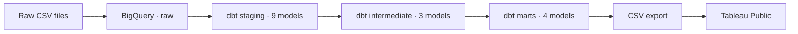

# local-bike-analytics
dbt + BigQuery analytics pipeline for a multi-store bike retailer: staging → marts, tested and documented, with a revenue dashboard.

# Local Bike — Operations Analytics

**Dashboard:** [Tableau Public — Local Bike Operations](https://public.tableau.com/views/LocalBike-Operationsdashboard/CommercialPerformance?:language=en-US&:sid=&:redirect=auth&:display_count=n&:origin=viz_share_link)

## Business problem

Local Bike is a young US bike retailer with three stores (Santa Cruz, Baldwin, Rowlett). This project gives the operations team a dashboard to:

- **Staffing:** spot workload imbalances between stores (revenue per salesperson).
- **Assortment:** push growing categories and monitor declining ones.
- **Inventory:** target dormant and overstock items by store and product (promotions, transfers).
- **Fulfillment:** track on-time delivery and the backlog of unshipped orders.

**Scope:** revenue = shipped orders, January 2016 to March 2018.

## Architecture & stack

- **Stack:** BigQuery, dbt Cloud, GitHub, Tableau Public.
- **Quality:** 81 dbt tests (generic and singular grain tests), full documentation persisted to BigQuery.
- **Why a static export:** Tableau Public has no live BigQuery connector; the dataset is frozen, so a CSV export of the marts is sufficient.

## Key findings

1. **Volume, not basket, drives revenue.** Average basket is similar across stores (~$4,600), yet Baldwin handles ~70% of orders with the same staff: ~$87K net revenue per salesperson per month vs ~$15K in Rowlett. The open question is why Baldwin attracts so much more traffic.
2. **The mix is shifting.** Q1 2018 vs Q1 2017: Electric Bikes +231%, Mountain Bikes −28%.
3. **Inventory is heavy.** ~$19.8M of stock at list price, about six years of sales ($19.8M ÷ ~$3.3M gross revenue per year), mostly overstock and dormant items. Dormant stock is concentrated in Rowlett.

## Design choices

- Revenue = shipped orders only (Jan 2016 – Mar 2018), net of line-level discounts.
- Marts read only from the intermediate layer, for a clear dependency flow.
- Materialization: views for staging and intermediate, tables for marts. Incremental models and partitioning were considered and rejected: under 5,000 rows, no measurable benefit.
- Composite keys tested with singular tests rather than an external package.
- **No branch protection on `main`.** As a solo project, changes still went through pull requests (feature branches, PR review, merge), but required approvals were not enforced since there was no second reviewer. In a team setting, I would require at least one approval and passing CI checks before merging.
- Ratios (basket, discount rate, late rate) recomputed in Tableau as ratios of sums, never averaged.

## Data limitations

- **Order status codes are undocumented.** Codes 1 and 2 only appear in April 2018 (125 orders), after the last shipment, consistent with orders still open at extraction time; code 3 never leads to a shipment. Labels were deliberately not assumed.
- No purchase cost, so no margin analysis.
- Stock is an undated snapshot.
- Late shipments (~32%) are uniform across stores and brands, likely a generation artifact.
- 12 status-3 orders are dated after the extraction period.

## How to run

1. Create a Google Cloud project with BigQuery and load the nine raw CSV files into a `raw` dataset (US location).
2. Configure the dbt connection to your project; never commit credentials.
3. Run `dbt build`: builds all models and runs the 81 tests.
4. Optional: `dbt docs generate` to browse documentation and lineage.

## What I would improve

- Add a store dimension to the category mart, to compare products and seasonality across stores.
- CI with GitHub Actions: `dbt build` on pull requests and SQL linting with SQLFluff.
- A warning-level dbt test flagging orders dated after the last shipment.
- An optimization audit of the dbt flow (repeated joins, query cost).
- Publish dbt docs and lineage on GitHub Pages.
